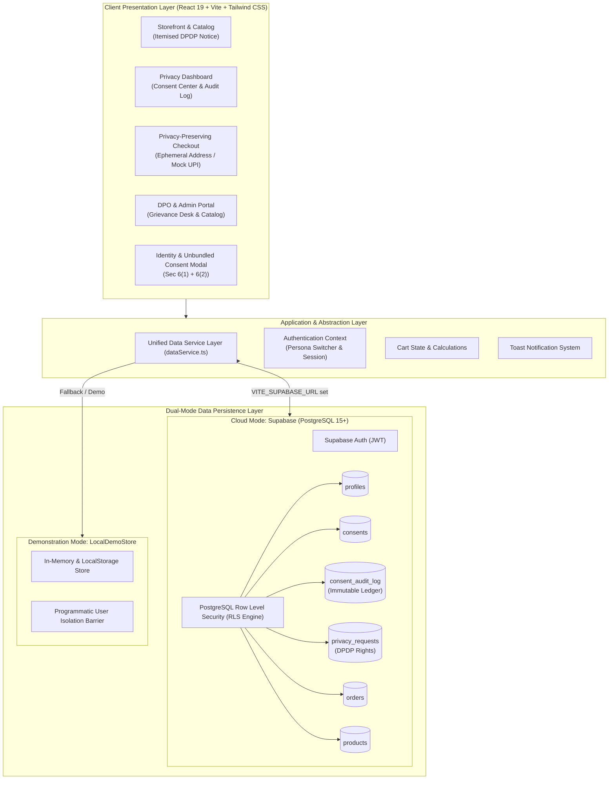

# PrivacyCart System Architecture

**Project:** Designing a Privacy-Preserving E-Commerce Web Application  
**Institution:** Savitribai Phule Pune University (SPPU) — Department of Computer Engineering  
**Curriculum:** Third-Year (TE) Computer Engineering Capstone / Mini-Project  
**Statutory Framework:** Digital Personal Data Protection (DPDP) Act, 2023 (India)

---

## 1. Architectural Overview

PrivacyCart is engineered under the **Privacy-by-Design** and **Data Minimisation** principles. Unlike traditional e-commerce platforms that bundle invasive analytics and marketing permissions into terms of service, PrivacyCart strictly separates and unbundles processing purposes, enforces granular consent controls, logs tamper-evident audit trails, and isolates user records using PostgreSQL Row Level Security (RLS).



---

## 2. Component Hierarchy & Flow

```
src/
├── main.tsx                         # React entry point
├── App.tsx                          # App root orchestrator & view router
│   ├── DemoModeBanner.tsx          # Top banner declaring academic mode & link status
│   ├── Navbar.tsx                   # Main navigation & viva persona switcher
│   ├── HomePage.tsx                 # Product catalog & DPDP hero
│   │   ├── ProductFilters.tsx       # Search, category pills, price sorting
│   │   ├── ProductCard.tsx          # Product card with privacy certification badge
│   │   └── ProductDetailsModal.tsx  # Itemised data notice disclosure modal
│   ├── PrivacyDashboardPage.tsx     # Data Principal self-service control center
│   │   ├── ConsentPreferencesCard.tsx # Granular unbundled toggles (Sec 6(4))
│   │   ├── ConsentAuditLogTable.tsx   # Immutable audit trail
│   │   ├── RequestHistoryList.tsx     # User's DPDP requests timeline
│   │   ├── PrivacyRequestModal.tsx    # Forms for Sec 11, 12, 13, 14 rights
│   │   └── DataExportButton.tsx       # Sec 11 JSON dossier download
│   ├── AdminDashboard.tsx           # Restricted portal for Data Protection Officer
│   │   ├── RequestReviewModal.tsx   # DPO adjudication modal (SLA tracking)
│   │   └── ProductManagementForm.tsx # Product catalog CRUD
│   ├── PrivacyPolicyPage.tsx        # Full statutory Section 5 legal notice
│   ├── CartDrawer.tsx               # Cart drawer
│   ├── MockCheckoutModal.tsx        # Data minimised checkout (zero real card info)
│   └── Footer.tsx                   # SPPU details, DPDP disclaimers, DPO contact
```

---

## 3. Privacy-by-Design Technical Pillars

### 3.1. Purpose Limitation & Itemised Notice (DPDP Section 5)
Traditional e-commerce collects personal details without per-item justification. PrivacyCart introduces:
- **Itemised Product Disclosures:** Every hardware token, shielded wallet, or book displays an individual data requirement statement before the user adds it to their cart.
- **Contractual Limitation (Section 4(1)(a)):** Shipping information is collected solely for logistics transit, never repurposed for behavioral analytics.

### 3.2. Unbundled Consent (DPDP Section 6(2))
- Mandatory processing consent (essential for delivering goods) is strictly separated from optional marketing consent.
- Under Section 6(2), refusal of marketing consent **does not** impair the customer's ability to browse or complete purchases.
- Consent preferences can be modified or withdrawn at any time with equal ease via the Privacy Dashboard (Section 6(4)).

### 3.3. Tamper-Evident Consent Audit Trail (DPDP Section 6(4) & 8(5))
- Every consent grant or revocation automatically generates an immutable ledger entry in `consent_audit_log`.
- Records store timestamp, consent version (`v1.0-2023`), masked client IP (`127.0.***.***`), and rationale.
- In PostgreSQL, `consent_audit_log` has **zero** UPDATE or DELETE policies, ensuring immutability.

### 3.4. Multi-User Row Level Security (RLS) Isolation
- PostgreSQL RLS enforces that a user whose JWT token contains `auth.uid()` can ONLY read or modify rows where `user_id = auth.uid()`.
- The database rejects unauthorized cross-user queries at the kernel level.
- Non-administrators cannot query another Data Principal's requests, consents, or order history.
- The same isolation is mathematically enforced in unit tests (`src/tests/privacy.test.ts`).

---

## 4. Security Protocols

1. **Zero Secret Exposure in Frontend:**
   - Only `VITE_SUPABASE_URL` and `VITE_SUPABASE_ANON_KEY` are used by the browser client.
   - Master PostgreSQL passwords and the `service_role` secret key are strictly excluded from frontend code.
2. **Zero Collection of Real Financial Data:**
   - Checkout implements a simulated mock payment gateway (Mock UPI / Mock COD / Mock NetBanking).
   - Real credit card numbers, CVVs, and banking passwords are never requested or stored.
3. **Fail-Closed Honest Error Reporting:**
   - If a database query or network operation fails, the system renders genuine error diagnostics rather than faking successful operations.
