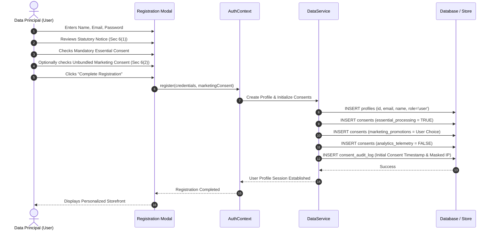
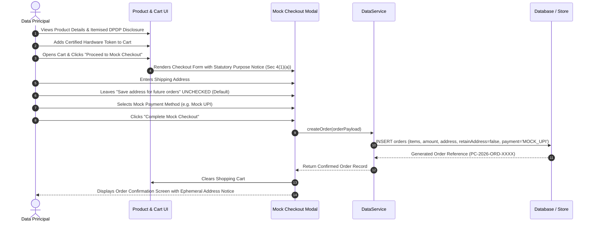
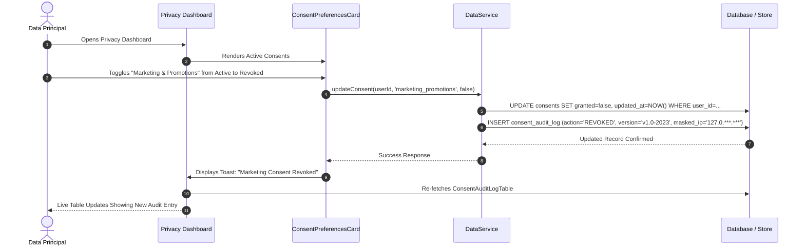
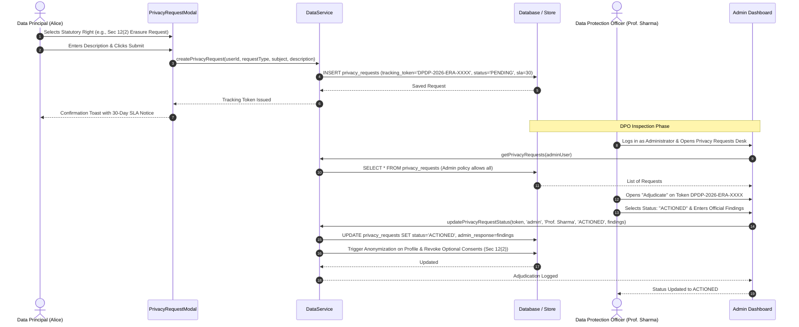
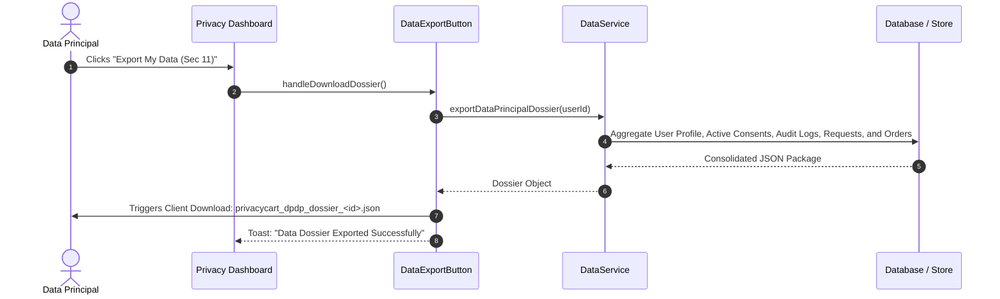

# PrivacyCart Data Flow Descriptions

**Project:** PrivacyCart — Designing a Privacy-Preserving E-Commerce Web Application  
**Statutory Alignment:** Digital Personal Data Protection (DPDP) Act, 2023 (India)

---

## 1. User Registration & Unbundled Consent Flow

---

## 2. Product Purchase & Data Minimised Checkout Flow

---

## 3. Consent Modification & Audit Logging Flow (DPDP Sec 6(4))

---

## 4. Statutory Rights Request & DPO Adjudication Flow (DPDP Sec 11-14)

---

## 5. DPDP Section 11 Data Portability Dossier Flow

